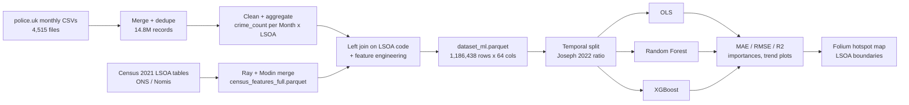

# UK Crime Prediction with Machine Learning

> Predicting monthly crime counts for every LSOA in England and Wales from 14.8M police records and Census 2021 socio-economic indicators.


*Coursework for 6001CMD Machine Learning, Coventry University, 2025-26 — Gabriel Pierre Huertas de Las Puertas.*

---

## Overview

**Prediction and analysis of socio-economic factors influencing crime in the United Kingdom using Machine
Learning techniques.**

Crime levels vary strongly across UK regions and districts, suggesting an influence of socio-economic
factors such as deprivation, unemployment, education and population density. This project builds an
end-to-end data pipeline and regression models that predict **monthly crime counts per LSOA** (Lower Layer
Super Output Area) for **2022–2025**, combining:

- **UK Police crime event data** (monthly street-level CSVs from police.uk)
- **Socio-economic indicators from Census 2021** (ONS / Nomis, LSOA level)
- **LSOA boundary shapefiles** for geospatial visualisation

Three regression models are compared — **Ordinary Least Squares (OLS)**, **Random Forest** and
**XGBoost** — using a chronologically consistent train / validation / test split whose proportions follow the
optimal data-splitting ratio proposed by **Joseph (2022)**.

The repository contains the full submission: the Jupyter notebook with all code, the academic report and
the presentation video.

## Key features

- **Large-scale ingestion** — merges 4,515 monthly police.uk CSVs into a single dataset of
  14,801,008 crime records, de-duplicated on `Crime ID`.
- **Cleaning & aggregation** — drops empty columns and rows without coordinates or LSOA code, then
  aggregates to crime counts per `Month × LSOA`.
- **Census 2021 feature store** — parallel merge (Ray + Modin) of census tables (population, density,
  household deprivation, economic activity, education) into one Parquet file covering 35,672 LSOAs.
- **Feature engineering** — year, month, quarter, season, crime rate per resident, previous-month crime
  count and month-on-month change.
- **Optimal temporal split** — Joseph (2022): train ≈ 79.9%, validation ≈ 8.9%, test ≈ 11.3%, split by month
  so the model never sees the future.
- **Model comparison** — OLS (standardised features), Random Forest (400 trees) and XGBoost
  (histogram method, early stopping on validation RMSE), evaluated with MAE, RMSE and R².
- **Interpretability & visualisation** — OLS top coefficients, Random Forest feature importances,
  per-LSOA and national real-vs-predicted trends, and an interactive Folium choropleth of predicted hotspots.

## Architecture



## Results

From the executed outputs in `ASSESMENT.IA.ipynb` (36 months of data; temporal split of 28 / 3 / 5 months =
921,169 / 98,269 / 167,000 rows):

| Model | Split | MAE | RMSE | R² |
|---|---|---|---|---|
| OLS | validation | 4.560 | 8.375 | 0.817 |
| OLS | test | 5.556 | 11.246 | 0.717 |
| Random Forest | validation | 0.031 | 2.662 | 0.982 |
| Random Forest | test | 0.030 | 1.230 | 0.997 |
| XGBoost | validation | 0.247 | 2.496 | 0.984 |
| XGBoost | test | 0.291 | 2.013 | 0.991 |

XGBoost national monthly trend on the test period (sum over all LSOAs): MAE 2363.794, R² 0.999.

> **Note on interpretation:** the engineered features `crime_rate` (crime count ÷ population) and
> `crime_change_pct` (change versus the previous month) are both computed from the current month's
> `crime_count`, so they carry information about the target. The tree-based scores above should therefore be
> read as an upper bound; a stricter evaluation would keep only lagged / census features.

## Tech stack

- **Language & environment:** Python 3.12, Jupyter Notebook
- **Data processing:** pandas, NumPy, Modin on Ray (parallel processing), Parquet (pyarrow), tqdm
- **Machine learning:** scikit-learn (`LinearRegression`, `RandomForestRegressor`, `SimpleImputer`,
  `StandardScaler`, metrics), XGBoost
- **Visualisation & GIS:** Matplotlib, seaborn, GeoPandas, Folium

## Getting started

### 1. Get the data

The original datasets cannot be uploaded due to their size and licensing terms. Download them from the
official sources:

- **UK Police crime data (monthly street-level CSVs):** <https://data.police.uk/data/>
- **UK Census 2021, LSOA tables (TS001, TS006, TS011, TS066, TS067):** <https://www.nomisweb.co.uk/sources/census_2021_bulk>
- **LSOA 2021 boundary shapefiles:** <https://geoportal.statistics.gov.uk/>

External datasets must be accessed and used according to the legal terms of their providers.

### 2. Install dependencies

```bash
python -m venv .venv
source .venv/bin/activate
pip install pandas numpy scipy scikit-learn xgboost matplotlib seaborn tqdm pyarrow jupyter
# Optional: parallel processing and maps
pip install "modin[ray]" geopandas folium
```

### 3. Run the notebook

```bash
jupyter notebook ASSESMENT.IA.ipynb
```

The notebook was executed on a multi-core server and uses absolute paths under `~/SERVIDOR/Jupyter/`
(e.g. `census2021/`, `uk_crime_merged_2025.csv`, `dataset_ml.parquet`). Update `BASE_DIR` and the file
paths in each cell to match where you stored the data, and adjust `num_cpus` / `n_jobs` (set to 24) to your
machine. Run the cells top to bottom: merge → clean → aggregate → census merge → final merge → split →
modelling → visualisation.

## Project structure

```
.
├── ASSESMENT.IA.ipynb                              # Full pipeline: ingestion, cleaning, features, models, plots
├── 6001CMD_Coursework _GH_25-26s1.docx             # Academic report: methodology, data, results, conclusions
├── simplescreenrecorder54-2025-12-01_12.24.25.mp4  # Presentation video (workflow, models, findings)
└── README.md
```

## Reference

V. R. Joseph (2022). *Optimal Ratio for Data Splitting.* Statistical Analysis and Data Mining 15(4): 531–538.
<https://arxiv.org/abs/2202.03326>

## Author

**Gabriel Pierre Huertas de Las Puertas** — Coventry University, 6001CMD Machine Learning coursework.

## License

This project is submitted exclusively for academic purposes under Coventry University regulations.
External datasets must be accessed and used according to the legal terms of their providers.
